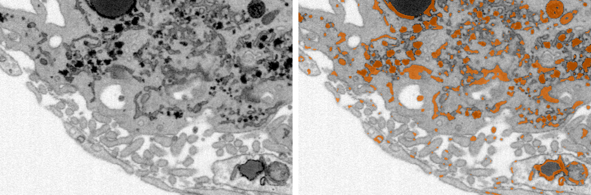

Use your own model
==================

This page describes how to run a model that you trained yourself in
cellmap-flow. Start from the section that matches your model:

- **A PyTorch network with a weights file:** it takes one short Python
  script. Follow `Quick start`_.
- **An ONNX or TorchScript file, or a model from DaCapo, Cellpose,
  fly_organelles, mia-train or the BioImage Model Zoo:** no script is needed.
  Go to `Models that need no script`_.
- **A model in another framework, such as TensorFlow:** see `Models that are
  not PyTorch`_.

If the model needs Python packages that cellmap-flow does not install, also
read `Models that need their own packages`_.

Quick start
-----------

**1. Write a script.** A script builds the network and states what it reads
and writes. The one below is a complete demo model that needs no weights: it
marks voxels that are clearly darker than their surroundings. Save it as
``my_model.py`` (it is also in the repository, as
``example/minimal_model.py``):

.. code-block:: python

    import torch
    import torch.nn.functional as F

    # What the network reads and writes.
    input_voxel_size = (8, 8, 8)     # nm, in z, y, x order
    output_voxel_size = (8, 8, 8)
    input_size = (64, 64, 64)        # voxels in
    output_size = (40, 40, 40)       # voxels out
    output_channels = 1
    channels = ["dark"]              # optional channel names

    class DarkStructures(torch.nn.Module):
        """Whether each voxel is clearly darker than the 25-voxel cube around it, as a probability."""

        def forward(self, x):
            nearby = F.avg_pool3d(x, 5, stride=1)[..., 10:-10, 10:-10, 10:-10]
            surroundings = F.avg_pool3d(x, 25, stride=1)
            darker = (surroundings - nearby) / (surroundings.abs() + 1e-6)
            return torch.sigmoid(30 * (darker - 0.1))

    # The network. Replace this with your own network and weights.
    model = DarkStructures()
    device = torch.device("cuda" if torch.cuda.is_available() else "cpu")
    model.to(device).eval()

**2. Test it.** This runs the model on one block of the data, on the current
machine, and prints ``Server check passed``. The data here is a public
mouse-liver volume; any zarr, N5 or precomputed path or URL works:

.. code-block:: bash

    DATA=https://janelia-cosem-datasets.s3.amazonaws.com/jrc_mus-liver/jrc_mus-liver.zarr/recon-1/em/fibsem-uint8
    cellmap_flow infer script -s my_model.py -d $DATA --server-check

**3. Run it.** This starts the model and opens the viewer and dashboard:

.. code-block:: bash

    cellmap_flow infer script -s my_model.py -d $DATA -q gpu_h100 -P your_charge_group

On a machine without a cluster, such as a Mac, omit ``-q`` and ``-P``. In a
dashboard that is already open, enter the script's path in **Add a model**
on the **Models** tab instead, and click *Resolve*, then *Run*.

The prediction appears as a layer over the data. The demo model on the
mouse-liver volume (left: the data; right: its prediction in orange):

Your own model
--------------

In the script, change the six values at the top and replace the network,
keeping the last two lines:

.. code-block:: python

    from my_package import MyNetwork     # must be an installed package

    model = MyNetwork()
    model.load_state_dict(torch.load("/path/to/weights.pt", map_location="cpu", weights_only=True))

Then check the following:

- **Sizes.** cellmap-flow calls ``model`` with one block at a time: a float32
  tensor of shape ``(1, 1, *input_size)``. The model must return
  ``(1, output_channels, *output_size)``. The two sizes may be equal.
- **Output activation.** If the network outputs logits, add a sigmoid in the
  script: ``model = torch.nn.Sequential(MyNetwork(), torch.nn.Sigmoid())``.
- **Packages.** If the network needs packages that cellmap-flow does not
  install, see `Models that need their own packages`_.
- **Input normalization.** This is not part of the script. Once the model is
  running, select the scaling that the network was trained with (for
  example, to [0, 1] or [-1, 1]) on the dashboard's **Processing** tab.

A model that runs from a script can also be finetuned in cellmap-flow. For
every script variable, voxel sizes that are not whole numbers, and networks
with several input channels, see :doc:`custom_script`.

Models that need no script
--------------------------

Models in these formats run directly. Enter the value in **Add a model**, or
pass it to ``cellmap_flow add``. If the model file does not contain a value
that is needed, such as the voxel size, **Add a model** asks for it.

.. list-table::
   :header-rows: 1
   :widths: 40 60

   * - Model
     - What to enter
   * - cellmap-models export (`Share a model`_)
     - its folder, or its Hugging Face repo, ``<you>/my-model``
   * - TorchScript file
     - ``/path/to/my_network.ts``
   * - ONNX file (:ref:`onnx`)
     - ``/path/to/my_model.onnx``
   * - fly_organelles checkpoint
     - ``/path/to/run08/model_checkpoint_438000``
   * - DaCapo run
     - ``dacapo:my_run@100000``
   * - mia-train model (:doc:`huggingface`)
     - its Hugging Face repo, ``ai-hhmi/lmd-vitl-p8-cellmap-lvd``
   * - Cellpose weights
     - ``cellpose:/path/to/weights``, or a built-in name such as ``cpsam``
   * - BioImage Model Zoo package (:doc:`bioimage`)
     - the folder or zip that holds its ``rdf.yaml``

A file of PyTorch weights alone is not accepted, because it does not define
the network: use a script. For the complete list of accepted paths and
names, see :ref:`resolving-models`.

Models that need their own packages
-----------------------------------

By default a model runs in the cellmap-flow environment. The built-in types
that need something else (Cellpose, fly_organelles, the BioImage Model Zoo,
ONNX, mia-train) each run in an environment of their own, which cellmap-flow
installs when it is first needed. Nothing has to be set for them.

A script whose network needs other packages runs in an environment that you
provide:

1. Create a conda environment or virtualenv that contains your packages.
2. Install cellmap-flow into it: ``pip install cellmap-flow``.
3. Pass the environment's path when starting the model, on the command line:

   .. code-block:: bash

       cellmap_flow infer script -s my_model.py -d $DATA --env /path/to/my_env

   or in a YAML configuration:

   .. code-block:: yaml

       models:
         my_model:
           type: script
           script_path: /path/to/my_model.py
           env: /path/to/my_env

Only the model runs in that environment; the dashboard keeps running in its
own. **Add a model** has no field for an environment, so start such a model
from the command line or from a YAML. For details, see :ref:`model-env`.

Share a model
-------------

A script only works where your code and weights are. To share a model,
export it: an export is a folder that contains the network and a
``metadata.json`` file, and runs without your code. The metadata holds the
same information as the script variables, plus the input normalization and
output activation, which the dashboard then applies for you. An exported
model can also be finetuned. Create an export with
`cellmap-models <https://github.com/janelia-cellmap/cellmap-models>`_:

.. code-block:: python

    import cellmap_models.model_export.config as c
    from cellmap_models.model_export import ModelMetadata, export_metadata, export_torch_model

    c.EXPORT_FOLDER = "/path/to/exports"

    model = ...  # your torch.nn.Module, weights loaded
    model.eval()

    metadata = ModelMetadata(
        model_name="my_model",
        model_type="UNet",
        framework="torch",
        spatial_dims=3,
        in_channels=1,
        out_channels=2,
        channels_names=["mito", "er"],
        iteration=100000,
        input_shape=[178, 178, 178],
        output_shape=[56, 56, 56],
        inference_input_shape=[178, 178, 178],
        inference_output_shape=[56, 56, 56],
        input_voxel_size=[8, 8, 8],
        output_voxel_size=[8, 8, 8],
        input_normalization={"method": "min_max", "min": -1.0, "max": 1.0},
        inference_output_activation={"name": "sigmoid", "apply_after_model": True},
        author="Your Name",
        description="Mitochondria and ER, trained on ...",
    )

    # Writes /path/to/exports/my_model/metadata.json (EXPORT_FOLDER/model_name).
    export_metadata(metadata, overwrite=True)
    # Writes the network into the same folder.
    export_torch_model(model, (1, 1, 178, 178, 178), "/path/to/exports/my_model")

To run the export, enter the folder's path in **Add a model**, or add it to
a YAML configuration:

.. code-block:: yaml

    models:
      my_model:
        type: cellmap
        folder_path: /path/to/exports/my_model

To share the export, upload the folder to a Hugging Face model repository.
Log in first, with ``hf auth login`` (``huggingface-cli login`` in older
versions of ``huggingface_hub``):

.. code-block:: python

    from cellmap_models.model_export import push_to_huggingface

    push_to_huggingface(folder_path="/path/to/exports/my_model", repo_id="<you>/my-model")

Other users can then run the model by entering ``<you>/my-model`` in **Add
a model** (:doc:`huggingface`).

.. note::

   An export runs only at the input size that it was exported with
   (178 voxels per side in this example), so export at the size that the
   model should run at.

Models that are not PyTorch
---------------------------

- **Convert the model to ONNX** and enter the ``.onnx`` file's path and input
  voxel size in **Add a model** (:ref:`onnx`).
- **Or write a script with its own prediction function.** Instead of
  ``model``, the script defines ``process_chunk``, which can use any
  library. ``example/tensorflow_lsd.py`` is a TensorFlow example
  (:doc:`custom_script`).

These models cannot be finetuned on the cluster, which trains PyTorch
networks only.

In the browser app
------------------

The `browser app <https://janelia-cellmap.github.io/cellmap-flow/app/>`_ runs
ONNX models on the user's own GPU, with nothing installed. A model that was
finetuned in cellmap-flow is made available there with *Publish to Hugging
Face* on the Finetune tab
(`docs/finetuning.md <https://github.com/janelia-cellmap/cellmap-flow/blob/main/docs/finetuning.md>`__).
For adding other ONNX models, see :doc:`browser`.

Troubleshooting
---------------

- **The model fails to start.** Run the test command from step 2, which
  prints the error in the terminal. "Shape validation failed" means that
  ``output_size`` or ``output_channels`` does not match what the network
  returns.
- **The job fails on the cluster.** Open **Job Logs** in the dashboard. An
  import error means that a package is missing from the environment that
  the model runs in (:ref:`model-env`).
- **The prediction is blank, constant or noisy.** Check the input
  normalization on the **Processing** tab, the sigmoid, and that the voxel
  sizes are in z, y, x order.
- **The data has a different voxel size from the model.** No action is
  needed: by default the data is resampled (:ref:`resampling`).
